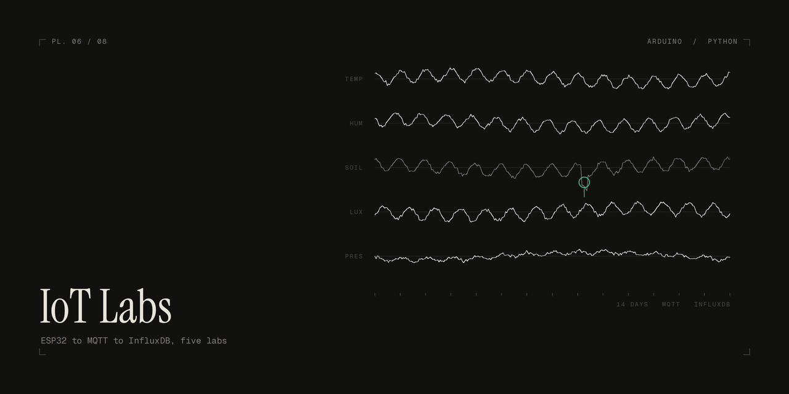

<p align="center"></p>

# Bennett IoT Labs

[](https://github.com/harshitpoooonia-star/bennett-iot-labs/actions/workflows/ci.yml)

Lab work for CSET480 IoT Analytics at Bennett University, 5th semester, odd 2026.

| Lab | Topic | Files |
|---|---|---|
| 1 | ESP32 sensor node publishing over MQTT, Node-RED flow, Python sensor simulator | `lab1/` |
| 2 | Cleaning a 24-hour sensor log: gaps, duplicates, outliers, interpolation | `lab2/` |
| 3 | Time-series analysis of IoT data | `lab3/` |
| 4 | Soil sensor data into InfluxDB with a Grafana dashboard and alert rule | `lab4/` |
| 5 | Machine learning on soil sensor data | `lab5/` |

`data/iot_timeseries_14day.csv` is the shared 14-day dataset.

## Setup

```
pip install -r requirements.txt
jupyter notebook
```

Labs 2, 3 and 5 are notebooks with their outputs saved, so you can read them on GitHub without running anything.

## Running lab 4

Start InfluxDB on `localhost:8086`, create an org called `iot_analytics_lab`, then:

```
export INFLUX_TOKEN=<your token>
python lab4/ingest.py
```

The ESP32 sketch in `lab1/` ships with placeholder WiFi credentials. Fill them in before flashing.

## License

MIT. See [LICENSE](LICENSE).
